# 测试与验收记录

## 2026-11-12 图片理解与以图搜图

把需求规格说明书里 AI-01～AI-07 落到了代码里：上传图片时就做分类、主色、敏感内容、描述与标题、向量，
发帖表单自动填好，详情页再按图片向量找外观相似的帖子。

### 新增接口

| 接口 | 说明 |
| --- | --- |
| `POST /analyze`（ai-service） | multipart 上传图片 + kind/location，返回 category/labels/colors/sensitive/description/title/embedding |
| `POST /embed/image` | 单张图片的 1000 维向量 |
| `POST /describe` | 由分类/颜色/地点拼描述与标题 |
| `POST /similar/vectors` | 给一组带向量的候选排序 |
| `POST /embed/text` | 文本向量 |
| `POST /api/v1/files`（后端） | 增加 `kind`、`location` 表单字段；响应新增 `ai` 对象 |
| `GET /api/v1/posts/{publicId}/similar-images` | 以图搜图，余弦相似度 ≥ 0.55，最多 N 条 |

### 实现要点

- 模型：`mobilenetv2-7.onnx`（分类 + 图片向量，1000 类）、`face_detection_yunet_2023mar.onnx`（人脸/证件区域），
  全部本地 CPU 推理，没有外部大模型；模型文件随 `ai-service/models` 提交（约 15 MB）。
- 上传链路：`FileService.upload` 先落盘与写 `file_object`，再同步调 AI；超时（默认 4 s）或报错时
  记录 `ai_status=FAILED` 并照常返回，**不阻断上传**。
- 向量：4000 字节 = 1000 维 float32，写 `file_object.embedding`，发帖时复制到 `item_image.embedding`。
- 前端：`ImageUploader` 上传后抛 `analyzed` 事件，`PublishDialog` 只在字段为空时填标题/描述/分类/颜色，
  并提示「已根据图片自动填写」；详情抽屉多一块「外观相似」。

### 验证结果

- ai-service：`pytest` 23 passed（新增 `test_vision.py` 覆盖分类、颜色、敏感区域、描述与向量）。
- 后端：`mvn test` 26 passed（File 4、Post 8、Claim 2、Auth 7、Admin 3、Health 2）。
- 前端：`vue-tsc --noEmit` 无错。
- 手工链路：`POST /analyze` 307 ms 返回完整结果；经后端上传后 `file_object.ai_status=DONE`、
  `embedding` 4000 字节；发帖后 `GET /posts/{id}/similar-images` 命中同一张图另发的帖子 `score=1.0`；
  发布弹窗选图后标题自动填成「捡到白色书籍」、分类「书籍」、颜色「白色」。

### 已知限制

- 分类来自 ImageNet 1000 类，校园小物件（钥匙、校园卡）识别率一般，因此描述里只把标签当「参考」，
  分类仍让用户确认；向量检索是内存暴力比对（候选上限 800 条），帖子量再大要换向量索引。
- 人脸/证件只做框选提示，不做打码；素材上传前仍由用户自行遮挡。

## W1 环境验收

验收日期：2026-10-30
验收人：Codex（本机 G:\软件工程）

| 项 | 命令 | 期望 | 结果 |
| --- | --- | --- | --- |
| Node.js | `node -v` | ≥ 20 | 通过：v22.22.1 |
| pnpm | `pnpm -v` | ≥ 9 | 通过：11.25.0（需一次性 `pnpm approve-builds --all`） |
| JDK | `java -version` | 21 | 通过：21.0.10 LTS |
| Maven | `mvn -v` | 3.9+ | 通过：4.0.0-rc-5（需绕过损坏的全局 settings.xml，见下） |
| Python | `py -3.13 --version` | ≥ 3.11 | 通过：3.13.14（虚拟环境内） |
| Docker 客户端 | `docker --version` | 可执行 | 通过：29.9.2 |
| Docker 守护进程 | `docker info` | 正常返回 | **未通过**：Docker Desktop 未启动 |
| 前端构建 | `pnpm build` | 成功 | 通过：3239 modules，产物在 `frontend/dist` |
| 前端启动 | `pnpm dev` | 5173 可访问 | 通过：HTTP 200 |
| 后端测试 | `mvn test` | 全部通过 | 通过：1 test, 0 failure |
| 后端健康检查 | `GET /api/v1/health` | `code=0` | 通过：8081 端口返回 UP |
| 前端代理 | `GET localhost:5173/api/v1/health` | `code=0` | 通过 |
| AI 测试 | `pytest -q` | 全部通过 | 通过：1 passed |
| AI 健康检查 | `GET /health` | `status=ok` | 通过：`model_loaded=false` |
| Compose 校验 | `docker compose config` | 无报错 | 通过（仅校验文件，未启动容器） |

截图：

- 
- 

### 本次发现的环境问题

| 问题 | 现象 | 处理 |
| --- | --- | --- |
| Maven 全局配置损坏 | `mvn` 报 `Non-parseable settings ... Unexpected close tag </settings>; expected </mirrors>`（第 149 行 `<mirrors>` 未闭合，且中间插入了 settings 不允许的 `<repositories>`） | 临时用 `.local/maven-settings.xml` 以 `-gs`/`-s` 绕过；**全局文件仍需修复**，见 README 常见问题 |
| 8080 端口被占用 | 后端启动报 `Port 8080 was already in use`，占用进程为 `steamwebhelper`（Steam） | 项目默认端口改为 8081，Vite 代理同步修改 |
| pip 强制离线 | `PIP_NO_INDEX=1`，安装依赖报 `No matching distribution found` | 安装时清除该环境变量；后续可用 `scripts/check-env.ps1` 自检 |
| 无头浏览器最小窗口宽度 | Edge headless 的窗口宽度下限约 504px，390px 截图被裁剪 | 用 `--force-device-scale-factor=1.29` 换算后再截图验证 |

### 待团队完成

- [ ] 在另两台电脑按 README 跑通三端（负责人：全员）
- [ ] 修复 Maven 全局 settings.xml 后，用原生 `mvn` 再跑一次 `mvn test`
- [ ] 启动 Docker Desktop 后执行 `docker compose -f deploy/docker-compose.dev.yml up -d` 并确认三个容器健康
- [ ] 设置 Git 身份并完成首次提交（当前仓库已 `git init`，尚无提交）

## 记录规则

- 每次验收追加一节，不覆盖历史。
- 失败项必须写：现象、报错原文、处理动作、负责人。
- 截图放 `docs/test/screenshots/`，文件名带日期。

## 2026-11-02 数据库设计验证

验证环境：Docker Compose，MySQL `8.4.3`，容器端口映射 `3307 -> 3306`，使用独立开发库 `lostfound`。

| 项 | 命令/检查 | 期望 | 结果 |
| --- | --- | --- | --- |
| MySQL 版本 | `SELECT VERSION()` | 8.4.3 | 通过 |
| 字符集与排序规则 | `@@character_set_server` / `@@collation_server` | `utf8mb4` / `utf8mb4_0900_ai_ci` | 通过 |
| 建表脚本 | 执行 `V1__init_schema.sql` | 无错误 | 通过 |
| 表数量 | `information_schema.tables` | 29 | 通过：29 |
| 外键数量 | `information_schema.referential_constraints` | 与脚本一致 | 通过：37 |
| 表引擎与排序规则 | 扫描全部表 | 全部 InnoDB / 统一排序规则 | 通过：0 张不一致 |
| 全文索引 | `item_post` 索引 | `ft_post_text(title, description)` | 通过，使用 `ngram` |
| 认领互斥 | `claim.active_flag` | STORED GENERATED | 通过；唯一键 `uk_claim_active(post_id, active_flag)` |
| 信息流索引 | `item_post` 索引 | 无大 offset 查询所需组合索引 | 通过：`idx_post_feed` 等存在 |

说明：本项验证的是 schema 可执行性与关键约束，尚未包含业务数据并发压测。并发认领唯一性将在认领模块的集成测试中验证。

## 2026-11-02 第一条业务链路

验证目标：从空库执行 Flyway，到后端公开查询接口、前端真实数据渲染和桌面/移动端浏览器检查全部贯通。

### 后端与数据库

```powershell
cd G:\软件工程\campus-lost-found\backend
$s = "G:\软件工程\campus-lost-found\.local\maven-settings.xml"
mvn -gs $s -s $s -B test
```

| 项 | 结果 |
| --- | --- |
| 后端测试 | 通过：6 tests，0 failure，0 error，0 skipped |
| Testcontainers | 通过：1.21.4，Docker Engine 29.9.2，临时 MySQL 8.4.3；Docker 不可用时测试明确失败而不是跳过 |
| 迁移验证 | 空库执行 V1、V2 成功，29 张业务表 + 1 张 Flyway 历史表 |
| 种子数据 | 20 个分类、9 条测试帖子（6 条可公开检索，3 条用于过滤边界） |
| 分类接口 | `GET /api/v1/categories` 返回 20 项，首项为 `campus-card` |
| 游标分页 | 第一页 `LF-2026-1031-01, LF-2026-1030-04`；第二页 `LF-2026-1030-02, LF-2026-1029-07` |
| ngram 搜索 | 关键词“保温杯”命中 `LF-2026-1029-03` |
| 详情接口 | `LF-2026-1031-01` 返回校园卡、图书馆、发布者与联系方式字段 |
| 错误响应 | 不存在或私有帖子返回 HTTP 404 / `40400`，响应包含 `traceId` |
| 筛选与边界 | `LOST` 返回 3 条、书籍分类返回 1 条；非法游标与类型返回 `40001` |
| OpenAPI | Redocly 校验通过；4 条提示均为公开 API、本地服务器或无需 4xx 的预期提示 |

### 前端

```powershell
cd G:\软件工程\campus-lost-found\frontend
pnpm typecheck
pnpm build
```

| 项 | 结果 |
| --- | --- |
| 类型检查 | 通过：`vue-tsc --noEmit` |
| 生产构建 | 通过：3241 modules；仅有 Element Plus 主包大于 500 kB 的提示 |
| 首页数据 | 6 条真实接口记录，默认类别显示“全部类别” |
| 搜索与筛选 | “保温杯”返回 1 条；“寻物启事”返回 3 条 |
| 详情抽屉 | 异步加载详情，桌面与移动端均正常展示 |
| 响应式 | 1440px 与 390px 均无横向溢出；移动端抽屉宽度 358.8px |
| 浏览器控制台 | 0 error、0 warning、0 页面异常、0 失败请求 |

浏览器检查使用本机 Edge 无头模式，覆盖页面加载、卡片点击、详情请求、关键词搜索和导航筛选。

### 截图

- 
- 
- 
- 
- 
- 

### 已知限制

- 当前统计数字只表示已加载页面内的记录，不代表全站总量。
- 发布、登录、认领与站内沟通仍是后续迭代范围，页面中未伪造这些能力。
- 前端构建产物偏大，后续引入路由级代码分割后再做体积优化。

## 2026-11-04 登录与个人资料

验证目标：验证码登录、JWT 访问令牌、HttpOnly 刷新令牌轮换、当前用户资料读写，以及登录弹窗、账号菜单和个人中心在桌面/移动端的完整交互。

### 后端

```powershell
cd G:\软件工程\campus-lost-found\backend
$s = "G:\软件工程\campus-lost-found\.local\maven-settings.xml"
mvn -gs $s -s $s -B test
```

| 项 | 结果 |
| --- | --- |
| 后端完整测试 | 通过：10 tests，0 failure，0 error，0 skipped |
| 登录集成测试 | 通过：4 tests，覆盖演示账号登录、缺失令牌与错误验证码、首次登录建档、刷新令牌轮换与重放拒绝 |
| 迁移验证 | 通过：V1、V2、V3 在空库依次执行，本地演示账号已绑定学号与手机号 |
| 真实接口冒烟 | 通过：发码 → 登录 → `/users/me` → 修改资料 → 刷新 → 退出，全部返回 `code=0` |
| 手机号脱敏 | 通过：接口返回 `138****0001` |
| 令牌轮换 | 通过：刷新后访问令牌变化，旧刷新令牌不可重放 |

### 前端

```powershell
cd G:\软件工程\campus-lost-found\frontend
npm run typecheck
npm run build
```

| 项 | 结果 |
| --- | --- |
| 类型检查 | 通过：`vue-tsc --noEmit` |
| 生产构建 | 通过：3247 modules；仍有 Element Plus 主包大于 500 kB 的提示 |
| 登录弹窗 | 验证码自动回填、错误提示、发送倒计时正常 |
| 会话恢复 | 页面刷新后通过刷新令牌恢复登录，账号菜单显示当前用户 |
| 资料保存 | 姓名、院系、宿舍、微信号保存成功，身份卡同步更新 |
| 退出登录 | 清除会话并回到未登录状态；个人中心重新显示登录引导 |
| 响应式 | 1440px 与 390px 均无横向溢出，弹窗、表单和账号菜单未发生遮挡 |
| 浏览器检查 | 16 项交互检查全部通过 |

浏览器检查使用本机 Edge + Playwright，覆盖桌面登录、资料保存、刷新恢复、移动端弹窗、错误提示和退出登录。

### 截图

- 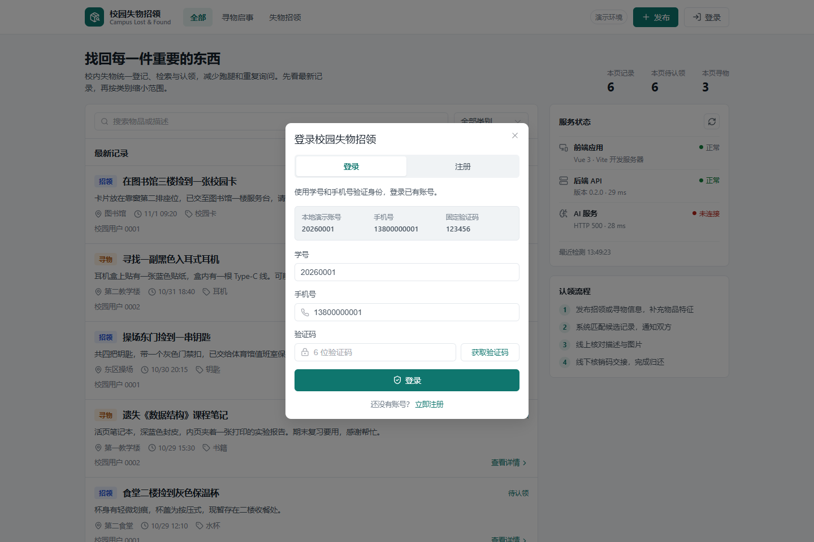
- 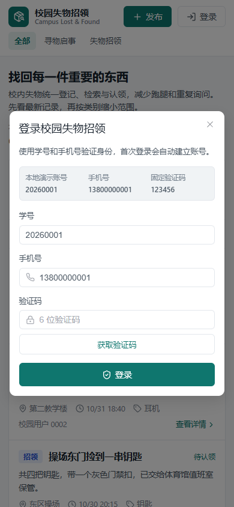
- 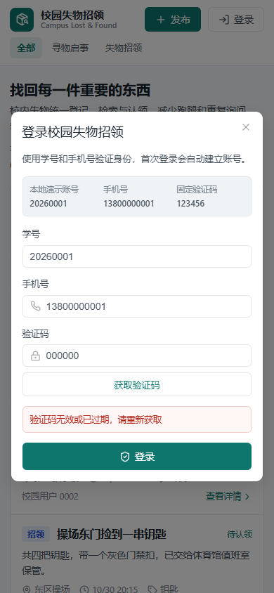
- 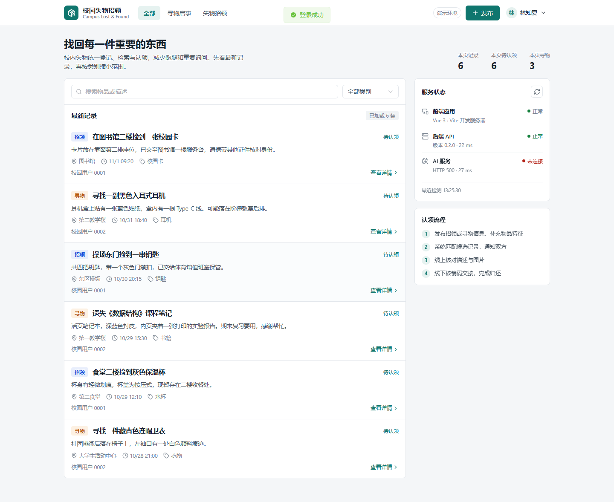
- 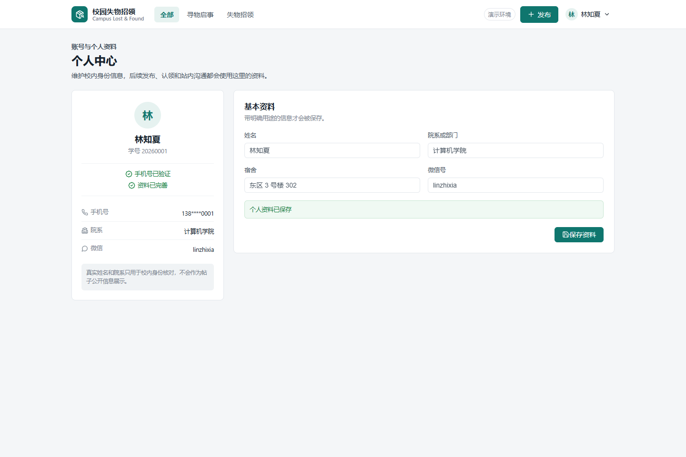
- 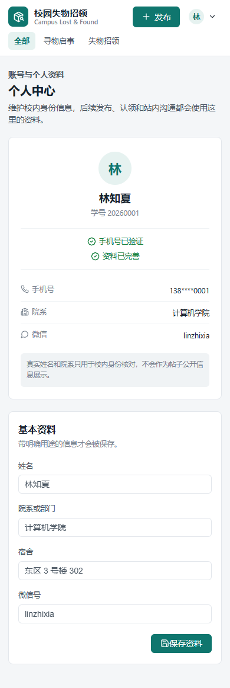

### 已知限制

- 访问令牌有效期 2 小时，当前只在页面加载时用刷新令牌恢复会话，尚未实现接口 401 时的静默续期。
- 固定验证码与验证码回显只用于本地演示；接入真实短信服务前不得用于公开部署。
- 后端使用 `local` 配置时才启用登录接口与数据库迁移，这是当前项目业务模块的统一约定。
- 浏览器控制台的 `401` 来自未登录时的会话探测，`500` 来自未启动的 AI 服务健康检查，均不影响登录流程。

## 2026-11-04 注册流程

验证目标：独立注册入口、学号/手机号重复校验、注册后自动登录与资料完善；登录行为同步调整为只允许已注册账号。

### 后端

```powershell
cd G:\软件工程\campus-lost-found\backend
$s = "G:\软件工程\campus-lost-found\.local\maven-settings.xml"
mvn -gs $s -s $s -B test
```

| 项 | 结果 |
| --- | --- |
| 后端完整测试 | 通过：12 tests，0 failure，0 error，0 skipped |
| 鉴权集成测试 | 通过：6 tests，覆盖注册成功、资料完善、重复学号、重复手机号、未注册账号登录与刷新令牌轮换 |
| 注册接口 | 通过：`POST /api/v1/auth/register` 校验固定验证码后创建学生账号并返回 HttpOnly 刷新令牌 |
| 重复校验 | 通过：重复学号返回 HTTP 409 / `40900`，重复手机号同样返回 `40900` |
| 登录行为 | 通过：未注册学号登录返回 `40100`，提示“账号不存在，请先注册” |
| 并发保护 | 通过：数据库唯一键冲突转换为业务冲突响应，不会返回 500 |

### 前端

```powershell
cd G:\软件工程\campus-lost-found\frontend
npm run typecheck
npm run build
```

| 项 | 结果 |
| --- | --- |
| 类型检查 | 通过：`vue-tsc --noEmit` |
| 生产构建 | 通过：3247 modules |
| 登录/注册切换 | 通过：分段切换，注册模式自动清空演示账号，避免误用已注册账号 |
| 注册流程 | 通过：填写学号/手机号 → 获取并回填验证码 → 注册并登录 → 跳转个人中心 |
| 资料完善 | 通过：注册用户保存姓名、院系、宿舍、微信后，身份卡与顶部账号名同步更新 |
| 会话恢复 | 通过：刷新页面后仍保持注册用户登录状态 |
| 错误提示 | 通过：重复学号与未注册登录均显示后端中文提示 |
| 响应式 | 通过：390px 移动端注册弹窗无横向溢出 |
| 浏览器检查 | 通过：11 项交互检查全部通过 |

### 截图

- 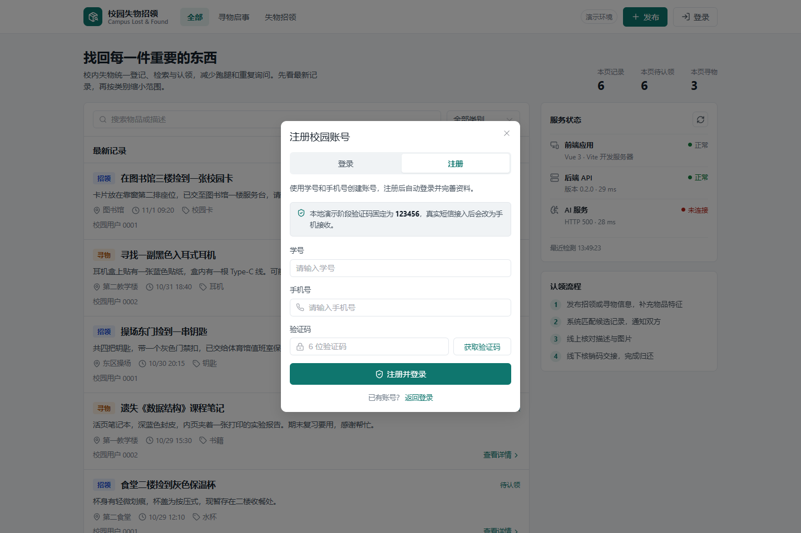
- 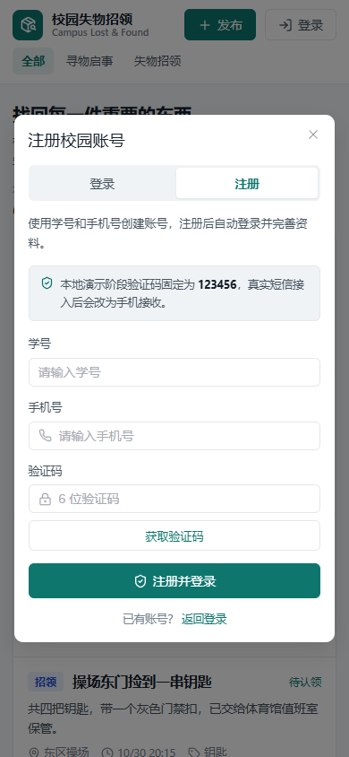
- 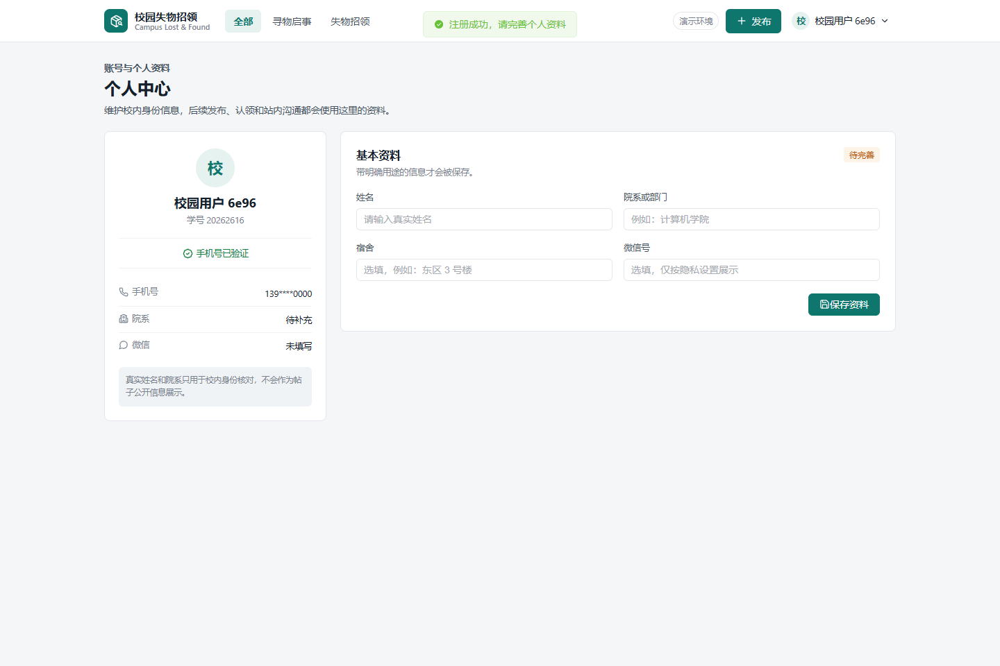
- 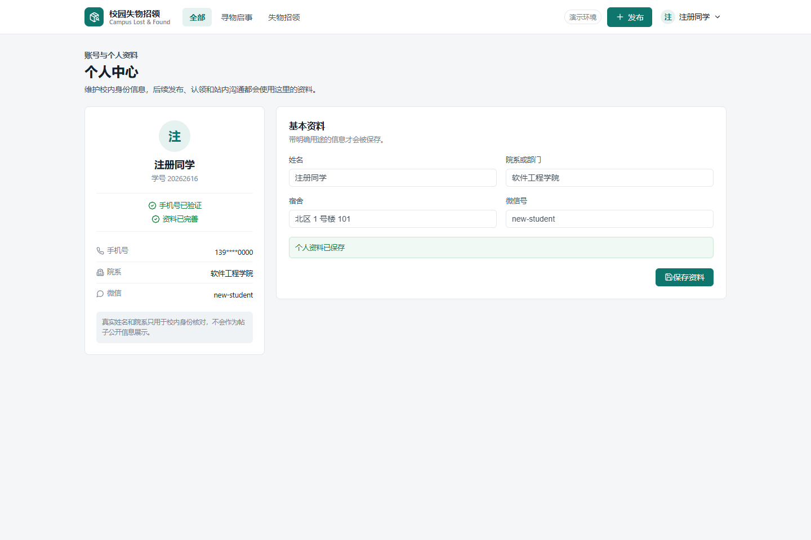
- 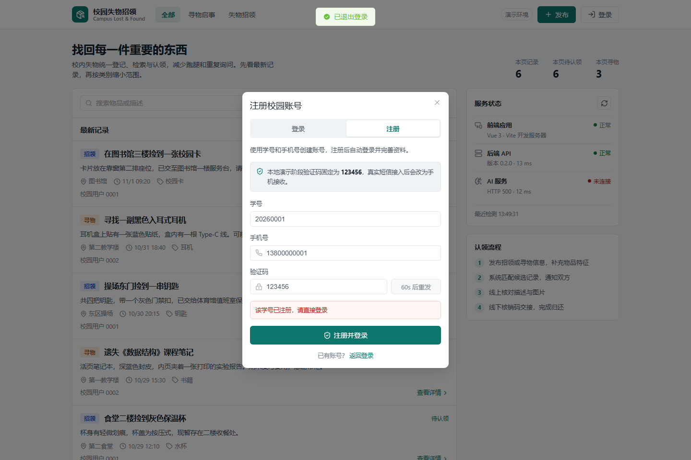

### 已知限制

- 注册验证码仍为本地固定值 `123456`，真实短信发送流程尚未接入。
- 注册只需要学号和手机号，暂未接入学校统一身份认证或邮箱验证。
- 登录不再自动建档；已有本地数据库中的自动建档账号不受影响。

## 2026-11-04 验证码获取流程修复

验证目标：注册时直接手填 `123456` 或获取后再改学号/手机号，能给出明确提示并阻止无效请求。

### 问题原因

固定验证码不等于永久有效。后端只有在调用 `POST /api/v1/auth/sms-code` 时才为「学号 + 手机号」写入一条 5 分钟有效的记录，校验时按这条记录比对。所以：

- 未点“获取验证码”直接提交，后端查不到记录，返回“验证码无效或已过期”。
- 获取后修改学号或手机号，记录与当前填写的账号不再匹配，同样失败。

### 修改内容

| 位置 | 修改 |
| --- | --- |
| `SmsCodeService` | 区分“未获取”与“已过期”：分别提示“请先获取验证码”“验证码已过期，请重新获取” |
| `LoginDialog.vue` | 记录验证码对应的学号+手机号；未获取时前端直接拦截，不发注册请求；账号变动时自动清空验证码、结束倒计时并提示重新获取；登录/注册切换不再误清验证码 |
| `AuthApiIntegrationTest` | 新增未请求验证码直接登录的用例 |
| 页面提示与 README | 补充“先点获取验证码，验证码会自动填入”的说明 |

### 验证结果

| 项 | 结果 |
| --- | --- |
| 后端完整测试 | 通过：13 tests，0 failure，0 error，0 skipped |
| 前端生产构建 | 通过：`vue-tsc --noEmit` + `vite build`，3247 modules |
| 未获取直接提交 | 通过：前端提示“请先获取验证码”，不发送注册请求 |
| 获取后修改手机号 | 通过：验证码自动清空、倒计时重置，需重新获取 |
| 正常流程 | 通过：获取验证码 → 自动填入 → 注册并登录 → 跳转个人中心 |

### 已知限制

- 验证码记录按「学号 + 手机号」匹配，暂不支持跨账号复用。
- 本地固定验证码仍只用于演示，公开部署前需替换为真实短信服务。

## 2026-11-04 本地跨域白名单修复

现象：点“获取验证码”后弹窗提示“请求失败（HTTP 403）”。

### 问题原因

`WebConfig` 里的跨域白名单只写了 `http://localhost:5173` 和 `http://127.0.0.1:5173`。Vite 在 5173 被占用时会自动换到 5174 等端口，此时浏览器带上的 `Origin` 不在白名单内，Spring 直接返回 403 `Invalid CORS request`，响应体不是 JSON，前端只能显示成“请求失败（HTTP 403）”。

复现方式：

```powershell
Invoke-WebRequest -Uri 'http://localhost:8091/api/v1/auth/sms-code' -Method POST `
  -ContentType 'application/json' -Headers @{ Origin = 'http://localhost:5174' } `
  -Body '{"studentNo":"23450987","phone":"18767589876"}'
```

修复前返回 403 `Invalid CORS request`，修复后返回 200。

### 修改内容

| 位置 | 修改 |
| --- | --- |
| `WebConfig` | 白名单改为 `allowedOriginPatterns("http://localhost:*", "http://127.0.0.1:*")`，本地任意端口可用 |
| `api/posts.ts` | 403 单独提示“请求被拒绝（HTTP 403），请确认访问地址与后端跨域配置” |

### 验证结果

| 项 | 结果 |
| --- | --- |
| 后端完整测试 | 通过：13 tests，0 failure，0 error |
| 前端类型检查 | 通过：`vue-tsc --noEmit` |
| 跨域 | 通过：`Origin` 为 5174、5175 时均不再返回 403 |
| 浏览器流程 | 通过：获取验证码 → 注册并登录全程正常 |

### 注意

- 白名单只覆盖 `localhost` 与 `127.0.0.1`，用局域网 IP 访问仍会被拒绝。
- 改动需要重启后端才生效；IDEA 里运行的那个实例要重新启动一次。

## 2026-11-05 发布帖子与管理后台

验证目标：把发帖从占位弹窗改成真实表单，并新增只对管理员开放的账号管理页。

### 新增接口

| 接口 | 说明 |
| --- | --- |
| `POST /api/v1/posts` | 登录后发布寻物/招领，字段校验后写入 `item_post` |
| `GET /api/v1/posts/mine` | 当前账号最近 50 条发布记录 |
| `GET /api/v1/locations` | 发帖时可选校园地点 |
| `GET /api/v1/admin/summary` | 账号数、封禁数、帖子数统计 |
| `GET /api/v1/admin/users` | 账号分页 + 关键词/状态筛选 |
| `PATCH /api/v1/admin/users/{publicId}/status` | 封禁/解封，写 `admin_audit_log` 并吊销刷新令牌 |

### 实现要点

| 位置 | 说明 |
| --- | --- |
| `PostService.create` | 校验类型、分类、地点、时间范围；生成 `LF-yyyyMMdd-XXXX` 编号；默认 30 天有效 |
| 发布状态 | 当前直接写入 `APPROVED/ACTIVE`，审核队列留待后续迭代 |
| 管理端权限 | `SecurityConfig` 中 `/api/v1/admin/**` 要求 `ROLE_ADMIN`，JWT 里的 `role` 参与鉴权 |
| 封禁效果 | 登录与刷新都会校验 `status`；封禁同时吊销该账号未过期的刷新令牌 |
| 管理端保护 | 不能修改自己的状态，不能封禁 `ADMIN` 角色账号 |
| 前端 | 新增 `PublishDialog.vue`、`AdminView.vue`、`api/admin.ts`、`feed` store；首页发布后自动刷新 |
| 数据 | `db/dev/V4__seed_local_admin_account.sql` 新增管理员演示账号 `admin` / `13900000000` |

### 验证结果

| 项 | 结果 |
| --- | --- |
| 后端编译 | 通过：`mvn test-compile` |
| 前端类型检查 | 通过：`vue-tsc --noEmit` |
| 前端生产构建 | 通过：`vite build`，AdminView 已按路由拆包 |
| 界面检查（模拟接口） | 通过：12 项，覆盖发布校验、发布请求字段、弹窗关闭、账号列表、封禁确认、管理员不可封禁、移动端无横向溢出 |
| 发布与管理员接口测试 | 已编写 `PostApiIntegrationTest` 新用例与 `AdminApiIntegrationTest`，**待 Docker 恢复后执行** |

### 待办

- 本次未执行后端集成测试：Docker Desktop 启动时报 `docker-secrets-engine/engine.sock` 残留导致引擎崩溃，需要重启机器释放该文件后重跑。
- 发帖暂不支持图片上传与 AI 打标。
- 发布后直接进入公开列表，尚未接入审核队列。
- 管理后台暂只覆盖账号状态，举报、帖子审核、角色变更留待后续。

## 2026-11-11 图片上传、认领闭环与通知

验证目标：把「发帖只有文字」和「捡到东西无法在平台内确认归属」两个缺口补上——图片可上传并展示，认领走完发起→发布者确认→线下交接→核销，每一步都给对方发站内通知。

### 新增接口

| 接口 | 说明 |
| --- | --- |
| `POST /api/v1/files` | 上传图片（multipart，字段名 `file`），识别 JPEG/PNG/GIF/WebP，返回地址与像素尺寸 |
| `GET /files/{key}` | 本地存储模式下直接提供图片访问（provider=local） |
| `POST /api/v1/posts/{publicId}/claims` | 发起认领，必须填写归属说明（≥5 字），可附联系方式与佐证图 |
| `GET /api/v1/claims/mine` | 我发起的认领 |
| `GET /api/v1/claims/received` | 别人对我发布的帖子发起的认领 |
| `GET /api/v1/claims/{publicId}` | 认领详情（仅当事人与管理员可见） |
| `POST /api/v1/claims/{publicId}/confirm` | 发布者同意认领，帖子转 `CLAIMING` |
| `POST /api/v1/claims/{publicId}/reject` | 发布者驳回，申请人可 `reopen` 重新提交 |
| `POST /api/v1/claims/{publicId}/cancel` | 申请人撤回 |
| `POST /api/v1/claims/{publicId}/complete` | 线下交接完成，帖子转 `CLAIMED` 并记录归还时间 |
| `GET /api/v1/notifications` | 通知列表（最近 50 条） |
| `GET /api/v1/notifications/unread-count` | 未读数，供顶栏角标轮询 |
| `POST /api/v1/notifications/{id}/read` | 单条已读 |
| `POST /api/v1/notifications/read-all` | 全部已读 |

### 实现要点

| 位置 | 说明 |
| --- | --- |
| `storage/StorageService` | 存储抽象：`LocalDiskStorage`（默认，写 `backend/data/files`，`/files/**` 映射）与 `S3Storage`（MinIO/兼容 S3，自签 SigV4，不引入新依赖） |
| 存储降级 | MinIO 不可用时**不阻断启动**，上传返回 `503 / 50301 文件存储暂不可用`，其余功能照常 |
| `file/FileService` | 按魔数识别类型（不信任 Content-Type）、算 SHA-256、写 `file_object`；`requireOwnedImage` 防越权引用他人图片 |
| 帖图关联 | `POST /posts` 的 `imageIds`（≤6）写入 `item_image`，主图取第一张，详情与列表返回 `images[]` |
| `claim/ClaimService` | 状态机 `PENDING → CONFIRMED → COMPLETED`，另有 `REJECTED / CANCELED`；DB 生成列 `active_flag` + 唯一键保证同帖只有一条进行中认领 |
| 权限边界 | 只有发布者能 confirm/reject/complete，只有申请人能 cancel/reopen；自己不能认领自己 |
| `notification/NotificationService` | 事件落库 + `dedupe_key` 去重；投稿、认领确认/驳回/交接各产生一条 |
| 前端 | `ImageUploader.vue`、`ClaimDialog.vue`、`ClaimsView.vue`、`NotificationsView.vue`，顶栏铃铛 60s 轮询未读数 |

### 验证结果

| 项 | 结果 |
| --- | --- |
| 后端测试 | 24 个用例全部通过（新增 `FileApiIntegrationTest` 4 个、`ClaimApiIntegrationTest` 2 个） |
| SigV4 签名校验 | 用独立 Python 校验器（`G:\dsh-workspace\python\mock_s3_verify.py`）重算 canonical request 比对签名，PUT 通过 |
| 存储降级 | 停掉 MinIO 后启动正常，上传返回 `503/50301`，`/api/v1/health` 与列表接口不受影响 |
| 前端类型检查 | 通过：`vue-tsc --noEmit` |
| 前端构建 | 通过：`vite build`，9.6 s |
| 端到端冒烟 | 上传 → 发帖带图 → 认领 → 驳回 → 重新提交 → 确认 → 核销 → 帖子转 `CLAIMED`，未读通知计数同步变化 |

### 已知限制

- 交接凭证 `verify_code_hash`、物品保管记录 `custody_record` 已有表结构但尚未在接口层使用，交接仍靠线下沟通 + 手动核销。
- 认领附属问题（`claim_question` / `claim_answer`）未开放，归属说明目前是一段自由文本。
- 图片未做缩略图与压缩，大于 5 MB 的图直接拒绝；`thumb_key` 字段预留。
- MinIO 直传改用预签名 URL 会更省后端带宽，当前选择后端中转是为了本地无 Docker 也能跑。


## 2026-11-11 候选匹配与 AI 服务

验证日期：2026-11-11
验证人：Codex（本机 G:\软件工程）

### 接口

| 方法 | 路径 | 说明 |
| --- | --- | --- |
| GET | `/api/v1/posts/{publicId}/matches` | 返回相反类型、状态为 ACTIVE/CLAIMING 的候选记录，按 score 降序，最多 5 条，附 `reasons` 说明得分来源 |

打分规则（`PostMatchService`）：同类别 +3、同一地点 +2、同品牌/同颜色各 +1、描述词元重合每项 +2（最多 3 项）。词元由中文二元组（bigram）与英文单词组成，`一张/一把/捡到/丢失/校园/有一` 等高频噪声词在切分时剔除，避免所有记录都被判为相似。

### AI 服务（ai-service 0.2.0）

| 方法 | 路径 | 说明 |
| --- | --- | --- |
| GET | `/health` | 状态、版本、`model_loaded`（当前恒为 false） |
| POST | `/similar` | `{text, candidates:[{id,text}], top_k}` → 带 score 与 shared 的排序结果 |
| POST | `/similar/pair` | 两条文本的 Jaccard 相似度 |
| POST | `/tags` | 抽取关键词，供表单联想 |

实现是纯 Python（`app/textmatch.py`），不加载模型，启动在 1 秒内；后续接入 CLIP 时替换实现即可，接口形状不变。

### 前端

- 详情抽屉新增「可能的匹配」区块：加载中提示、空态文案、候选列表（类型标签、标题、相似度、命中理由）。
- 列表卡片显示封面图（`primary` 优先），无图时回退图标占位。
- 抽屉底部新增「我要认领 / 登录后认领」按钮，接 `ClaimDialog`。

### 验证结果

- 后端 `mvn -q -B test`：25 个测试通过（含新增 `returnsMatchCandidatesAndRejectsUnknownPost`）。
- AI 服务 `.venv\Scripts\python.exe -m pytest -q`：8 个测试通过。
- 前端 `npm run typecheck`：通过。
- 实机验证：`GET /api/v1/posts/LF-20261111-XS5X/matches` 返回 1~3 条候选；`http://localhost:5173/ai/health` 经 Vite 代理返回 `ok / v0.2.0`，首页服务状态卡中 AI 服务显示「服务正常，模型未加载」。
- 页面截图：首页列表封面、详情抽屉（图集 + 候选匹配 + 认领入口）、认领管理、通知中心均正常；控制台仅剩未登录时的 401（预期）。

### 环境备注

- MySQL 容器的 3307 端口落在 Windows 保留端口段（3307–3406），容器无法绑定；已改写 `deploy/.env` 的 `MYSQL_PORT=13306` 并重建容器，后端启动需带 `MYSQL_PORT=13306`。
- Vite 在 IPv6 上监听（`::1`），浏览器与本机脚本都要用 `http://localhost:5173`，`127.0.0.1` 会连不上。

### 2026-11-11 AI 服务接入匹配与 Docker 一键部署

后端新增 `ai/AiTextClient`（`java.net.http`，超时 800ms）：`PostMatchService` 把「标题 + 描述」批量发给 AI 服务的 `POST /similar`，
拿到 0~1 的相似度后按 1 分 ≈ 0.25 折算进总分，理由里出现「语义相似 xx%」。AI 未启动、超时、返回非 2xx 时静默退回本地中文二元组打分，
所以单独跑后端仍然可用。

- 配置：`AI_ENABLED` / `AI_BASE_URL`（默认 `http://127.0.0.1:8000`）/ `AI_TIMEOUT_MS`（默认 800）/ `AI_LOG_LEVEL`（排查时可设 DEBUG）
- 接口约束：`/similar` 的 `top_k` 放宽到 200，因为后端一次提交整批候选（最多 80 条）要拿全量分数
- 实测：发一条「在操场看台捡到一副黑色入耳式耳机」的招领帖后，查寻物帖的匹配结果里出现
  `同类别 · 耳机 / 同颜色 · 黑色 / 语义相似 15%`

Docker：新增 `.dockerignore`、`deploy/docker/{backend,frontend,ai}.Dockerfile`、`deploy/docker/nginx.conf`、
`deploy/docker-compose.prod.yml`、`deploy/.env.docker.example` 与 `deploy/DOCKER.md`，`docker compose -f docker-compose.prod.yml up -d --build`
一条命令起 mysql + backend + ai + nginx（前端静态站与反向代理）。实测四个容器全部 healthy，健康检查、登录、上传、带图发帖、
静态图片访问、AI 参与的匹配结果均通过（详见 `deploy/DOCKER.md` 的验证段落）。

踩到的三个坑已写进 `deploy/DOCKER.md` 排查表：pnpm 9 把 `pnpm-workspace.yaml` 当工作区根；缺 `.dockerignore` 导致本机
`node_modules` 盖掉容器依赖（`vue-tsc` 找不到）；`pom.xml` 的 `../db` 相对路径要求镜像内 pom 在 `/src/backend`。
