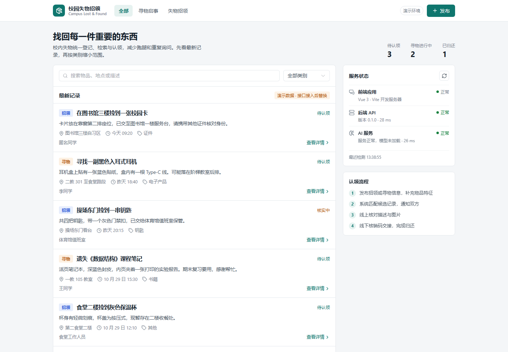

# 测试与验收记录

## W1 环境验收

验收日期：2026-10-30
验收人：Codex（本机 G:\软件工程）

| 项 | 命令 | 期望 | 结果 |
| --- | --- | --- | --- |
| Node.js | `node -v` | ≥ 20 | 通过：v22.22.1 |
| pnpm | `pnpm -v` | ≥ 9 | 通过：11.25.0（需一次性 `pnpm approve-builds --all`） |
| JDK | `java -version` | 21 | 通过：21.0.10 LTS |
| Maven | `mvn -v` | 3.9+ | 通过：4.0.0-rc-5（需绕过损坏的全局 settings.xml，见下） |
| Python | `py -3.13 --version` | ≥ 3.11 | 通过：3.13.14（虚拟环境内） |
| Docker 客户端 | `docker --version` | 可执行 | 通过：29.9.2 |
| Docker 守护进程 | `docker info` | 正常返回 | **未通过**：Docker Desktop 未启动 |
| 前端构建 | `pnpm build` | 成功 | 通过：3239 modules，产物在 `frontend/dist` |
| 前端启动 | `pnpm dev` | 5173 可访问 | 通过：HTTP 200 |
| 后端测试 | `mvn test` | 全部通过 | 通过：1 test, 0 failure |
| 后端健康检查 | `GET /api/v1/health` | `code=0` | 通过：8081 端口返回 UP |
| 前端代理 | `GET localhost:5173/api/v1/health` | `code=0` | 通过 |
| AI 测试 | `pytest -q` | 全部通过 | 通过：1 passed |
| AI 健康检查 | `GET /health` | `status=ok` | 通过：`model_loaded=false` |
| Compose 校验 | `docker compose config` | 无报错 | 通过（仅校验文件，未启动容器） |

截图：

- 
- 

### 本次发现的环境问题

| 问题 | 现象 | 处理 |
| --- | --- | --- |
| Maven 全局配置损坏 | `mvn` 报 `Non-parseable settings ... Unexpected close tag </settings>; expected </mirrors>`（第 149 行 `<mirrors>` 未闭合，且中间插入了 settings 不允许的 `<repositories>`） | 临时用 `.local/maven-settings.xml` 以 `-gs`/`-s` 绕过；**全局文件仍需修复**，见 README 常见问题 |
| 8080 端口被占用 | 后端启动报 `Port 8080 was already in use`，占用进程为 `steamwebhelper`（Steam） | 项目默认端口改为 8081，Vite 代理同步修改 |
| pip 强制离线 | `PIP_NO_INDEX=1`，安装依赖报 `No matching distribution found` | 安装时清除该环境变量；后续可用 `scripts/check-env.ps1` 自检 |
| 无头浏览器最小窗口宽度 | Edge headless 的窗口宽度下限约 504px，390px 截图被裁剪 | 用 `--force-device-scale-factor=1.29` 换算后再截图验证 |

### 待团队完成

- [ ] 在另两台电脑按 README 跑通三端（负责人：全员）
- [ ] 修复 Maven 全局 settings.xml 后，用原生 `mvn` 再跑一次 `mvn test`
- [ ] 启动 Docker Desktop 后执行 `docker compose -f deploy/docker-compose.dev.yml up -d` 并确认三个容器健康
- [ ] 设置 Git 身份并完成首次提交（当前仓库已 `git init`，尚无提交）

## 记录规则

- 每次验收追加一节，不覆盖历史。
- 失败项必须写：现象、报错原文、处理动作、负责人。
- 截图放 `docs/test/screenshots/`，文件名带日期。

