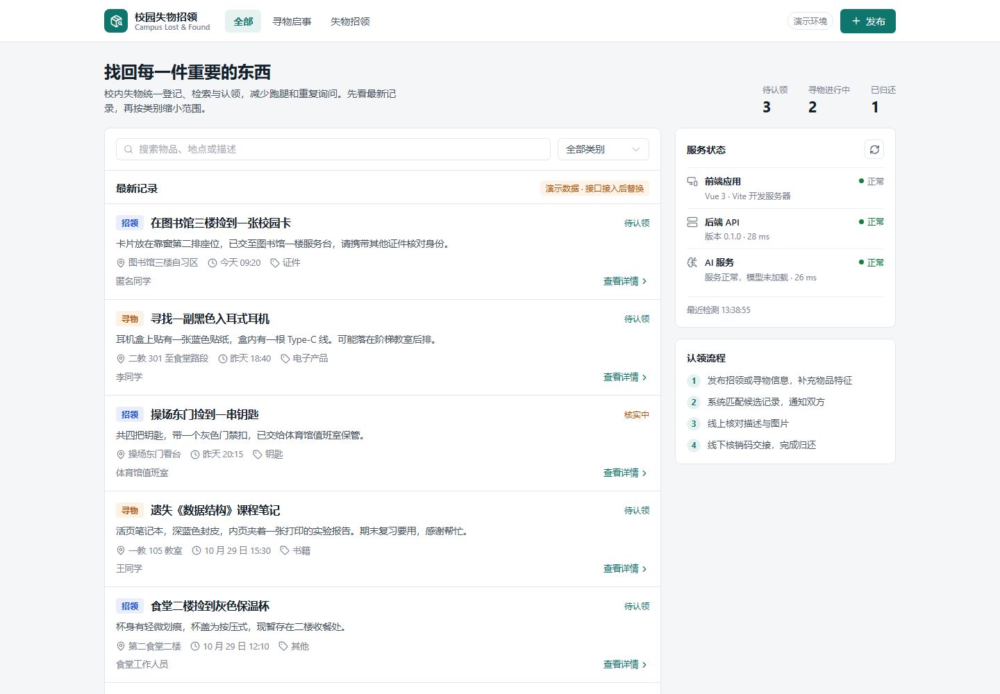
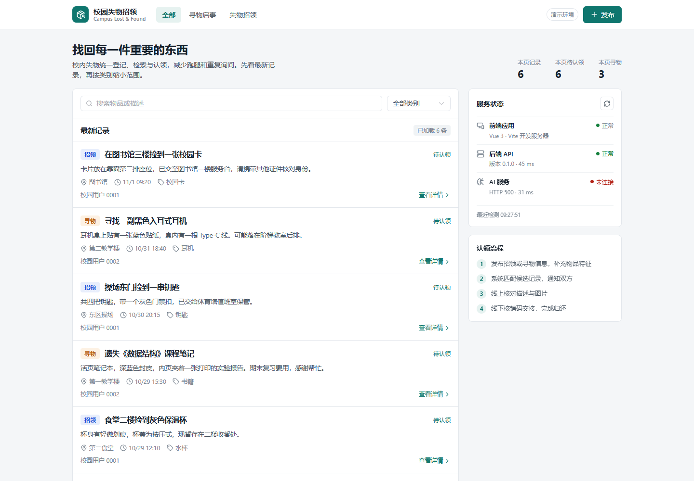
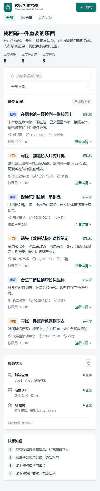
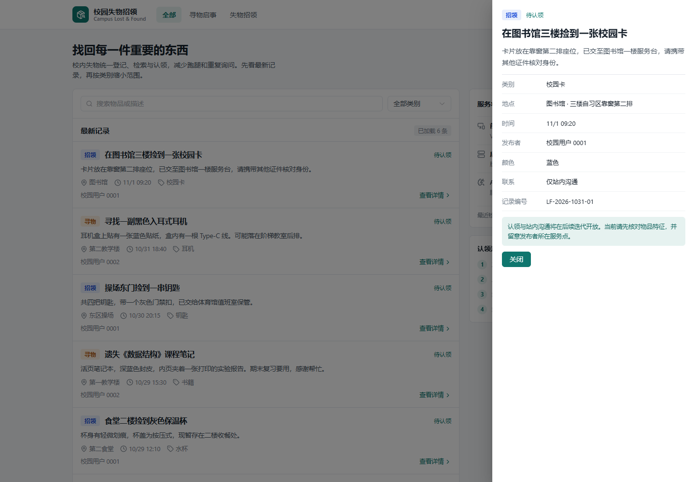
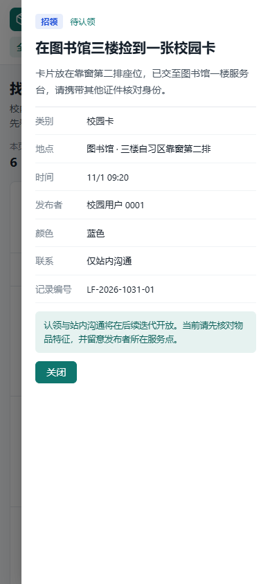
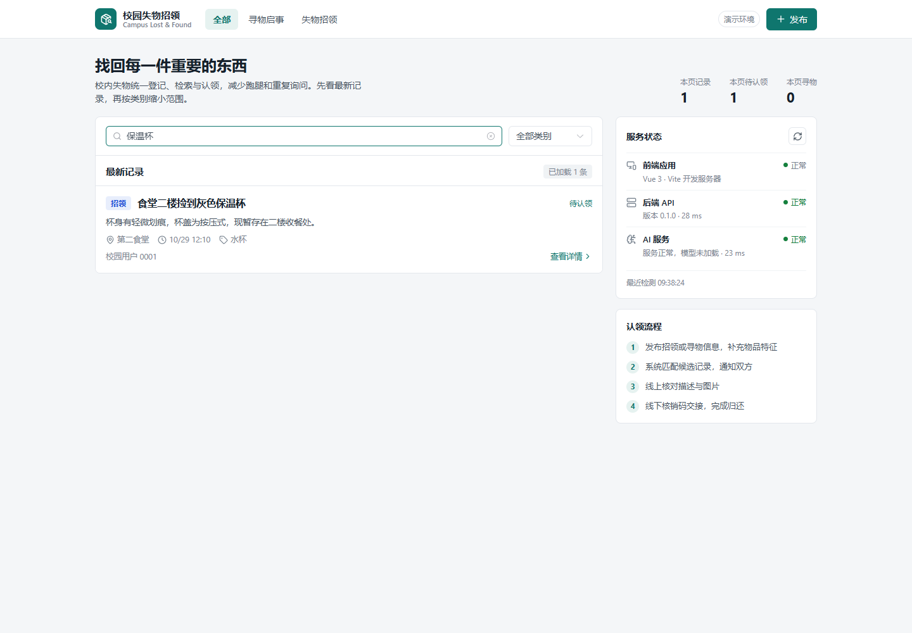
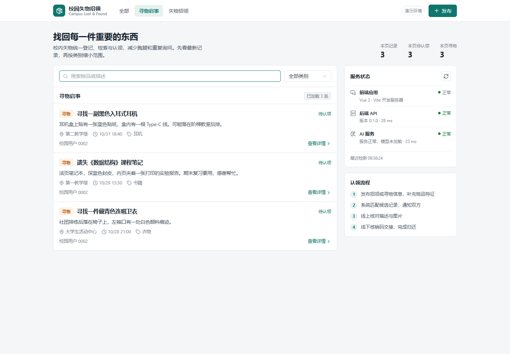

# 测试与验收记录

## W1 环境验收

验收日期：2026-10-30
验收人：Codex（本机 G:\软件工程）

| 项 | 命令 | 期望 | 结果 |
| --- | --- | --- | --- |
| Node.js | `node -v` | ≥ 20 | 通过：v22.22.1 |
| pnpm | `pnpm -v` | ≥ 9 | 通过：11.25.0（需一次性 `pnpm approve-builds --all`） |
| JDK | `java -version` | 21 | 通过：21.0.10 LTS |
| Maven | `mvn -v` | 3.9+ | 通过：4.0.0-rc-5（需绕过损坏的全局 settings.xml，见下） |
| Python | `py -3.13 --version` | ≥ 3.11 | 通过：3.13.14（虚拟环境内） |
| Docker 客户端 | `docker --version` | 可执行 | 通过：29.9.2 |
| Docker 守护进程 | `docker info` | 正常返回 | **未通过**：Docker Desktop 未启动 |
| 前端构建 | `pnpm build` | 成功 | 通过：3239 modules，产物在 `frontend/dist` |
| 前端启动 | `pnpm dev` | 5173 可访问 | 通过：HTTP 200 |
| 后端测试 | `mvn test` | 全部通过 | 通过：1 test, 0 failure |
| 后端健康检查 | `GET /api/v1/health` | `code=0` | 通过：8081 端口返回 UP |
| 前端代理 | `GET localhost:5173/api/v1/health` | `code=0` | 通过 |
| AI 测试 | `pytest -q` | 全部通过 | 通过：1 passed |
| AI 健康检查 | `GET /health` | `status=ok` | 通过：`model_loaded=false` |
| Compose 校验 | `docker compose config` | 无报错 | 通过（仅校验文件，未启动容器） |

截图：

- 
- 

### 本次发现的环境问题

| 问题 | 现象 | 处理 |
| --- | --- | --- |
| Maven 全局配置损坏 | `mvn` 报 `Non-parseable settings ... Unexpected close tag </settings>; expected </mirrors>`（第 149 行 `<mirrors>` 未闭合，且中间插入了 settings 不允许的 `<repositories>`） | 临时用 `.local/maven-settings.xml` 以 `-gs`/`-s` 绕过；**全局文件仍需修复**，见 README 常见问题 |
| 8080 端口被占用 | 后端启动报 `Port 8080 was already in use`，占用进程为 `steamwebhelper`（Steam） | 项目默认端口改为 8081，Vite 代理同步修改 |
| pip 强制离线 | `PIP_NO_INDEX=1`，安装依赖报 `No matching distribution found` | 安装时清除该环境变量；后续可用 `scripts/check-env.ps1` 自检 |
| 无头浏览器最小窗口宽度 | Edge headless 的窗口宽度下限约 504px，390px 截图被裁剪 | 用 `--force-device-scale-factor=1.29` 换算后再截图验证 |

### 待团队完成

- [ ] 在另两台电脑按 README 跑通三端（负责人：全员）
- [ ] 修复 Maven 全局 settings.xml 后，用原生 `mvn` 再跑一次 `mvn test`
- [ ] 启动 Docker Desktop 后执行 `docker compose -f deploy/docker-compose.dev.yml up -d` 并确认三个容器健康
- [ ] 设置 Git 身份并完成首次提交（当前仓库已 `git init`，尚无提交）

## 记录规则

- 每次验收追加一节，不覆盖历史。
- 失败项必须写：现象、报错原文、处理动作、负责人。
- 截图放 `docs/test/screenshots/`，文件名带日期。

## 2026-11-02 数据库设计验证

验证环境：Docker Compose，MySQL `8.4.3`，容器端口映射 `3307 -> 3306`，使用独立开发库 `lostfound`。

| 项 | 命令/检查 | 期望 | 结果 |
| --- | --- | --- | --- |
| MySQL 版本 | `SELECT VERSION()` | 8.4.3 | 通过 |
| 字符集与排序规则 | `@@character_set_server` / `@@collation_server` | `utf8mb4` / `utf8mb4_0900_ai_ci` | 通过 |
| 建表脚本 | 执行 `V1__init_schema.sql` | 无错误 | 通过 |
| 表数量 | `information_schema.tables` | 29 | 通过：29 |
| 外键数量 | `information_schema.referential_constraints` | 与脚本一致 | 通过：37 |
| 表引擎与排序规则 | 扫描全部表 | 全部 InnoDB / 统一排序规则 | 通过：0 张不一致 |
| 全文索引 | `item_post` 索引 | `ft_post_text(title, description)` | 通过，使用 `ngram` |
| 认领互斥 | `claim.active_flag` | STORED GENERATED | 通过；唯一键 `uk_claim_active(post_id, active_flag)` |
| 信息流索引 | `item_post` 索引 | 无大 offset 查询所需组合索引 | 通过：`idx_post_feed` 等存在 |

说明：本项验证的是 schema 可执行性与关键约束，尚未包含业务数据并发压测。并发认领唯一性将在认领模块的集成测试中验证。

## 2026-11-02 第一条业务链路

验证目标：从空库执行 Flyway，到后端公开查询接口、前端真实数据渲染和桌面/移动端浏览器检查全部贯通。

### 后端与数据库

```powershell
cd G:\软件工程\campus-lost-found\backend
$s = "G:\软件工程\campus-lost-found\.local\maven-settings.xml"
mvn -gs $s -s $s -B test
```

| 项 | 结果 |
| --- | --- |
| 后端测试 | 通过：6 tests，0 failure，0 error，0 skipped |
| Testcontainers | 通过：1.21.4，Docker Engine 29.9.2，临时 MySQL 8.4.3；Docker 不可用时测试明确失败而不是跳过 |
| 迁移验证 | 空库执行 V1、V2 成功，29 张业务表 + 1 张 Flyway 历史表 |
| 种子数据 | 20 个分类、9 条测试帖子（6 条可公开检索，3 条用于过滤边界） |
| 分类接口 | `GET /api/v1/categories` 返回 20 项，首项为 `campus-card` |
| 游标分页 | 第一页 `LF-2026-1031-01, LF-2026-1030-04`；第二页 `LF-2026-1030-02, LF-2026-1029-07` |
| ngram 搜索 | 关键词“保温杯”命中 `LF-2026-1029-03` |
| 详情接口 | `LF-2026-1031-01` 返回校园卡、图书馆、发布者与联系方式字段 |
| 错误响应 | 不存在或私有帖子返回 HTTP 404 / `40400`，响应包含 `traceId` |
| 筛选与边界 | `LOST` 返回 3 条、书籍分类返回 1 条；非法游标与类型返回 `40001` |
| OpenAPI | Redocly 校验通过；4 条提示均为公开 API、本地服务器或无需 4xx 的预期提示 |

### 前端

```powershell
cd G:\软件工程\campus-lost-found\frontend
pnpm typecheck
pnpm build
```

| 项 | 结果 |
| --- | --- |
| 类型检查 | 通过：`vue-tsc --noEmit` |
| 生产构建 | 通过：3241 modules；仅有 Element Plus 主包大于 500 kB 的提示 |
| 首页数据 | 6 条真实接口记录，默认类别显示“全部类别” |
| 搜索与筛选 | “保温杯”返回 1 条；“寻物启事”返回 3 条 |
| 详情抽屉 | 异步加载详情，桌面与移动端均正常展示 |
| 响应式 | 1440px 与 390px 均无横向溢出；移动端抽屉宽度 358.8px |
| 浏览器控制台 | 0 error、0 warning、0 页面异常、0 失败请求 |

浏览器检查使用本机 Edge 无头模式，覆盖页面加载、卡片点击、详情请求、关键词搜索和导航筛选。

### 截图

- 
- 
- 
- 
- 
- 

### 已知限制

- 当前统计数字只表示已加载页面内的记录，不代表全站总量。
- 发布、登录、认领与站内沟通仍是后续迭代范围，页面中未伪造这些能力。
- 前端构建产物偏大，后续引入路由级代码分割后再做体积优化。

